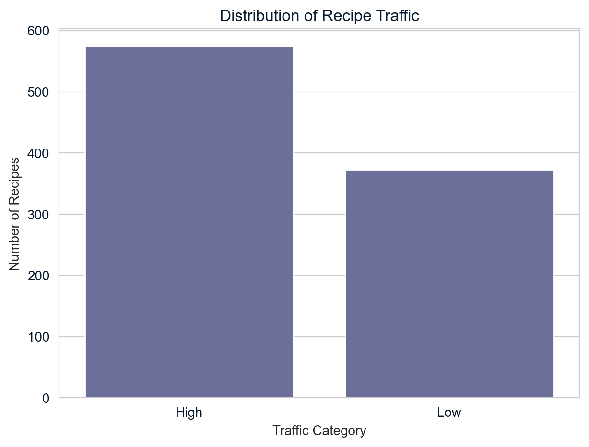
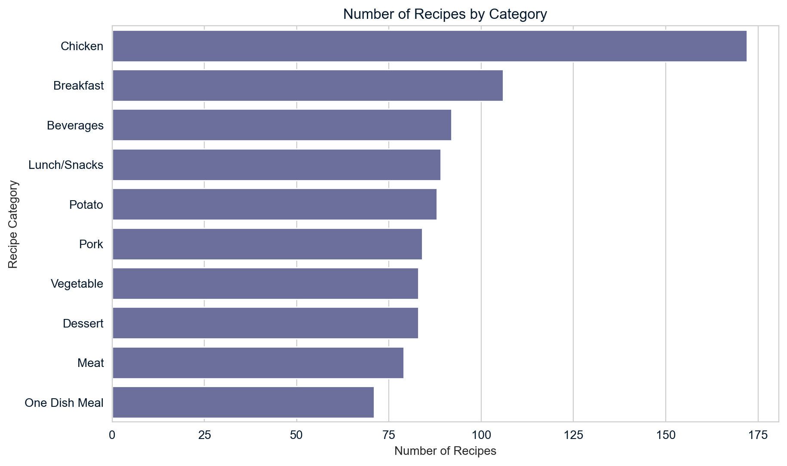
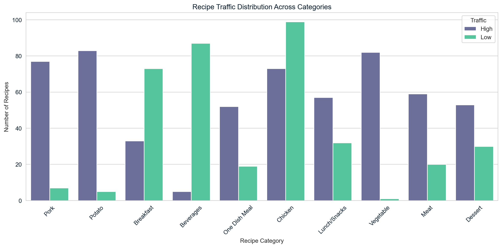
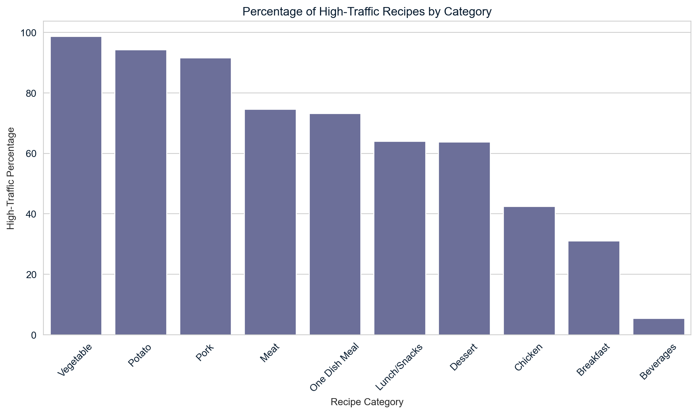
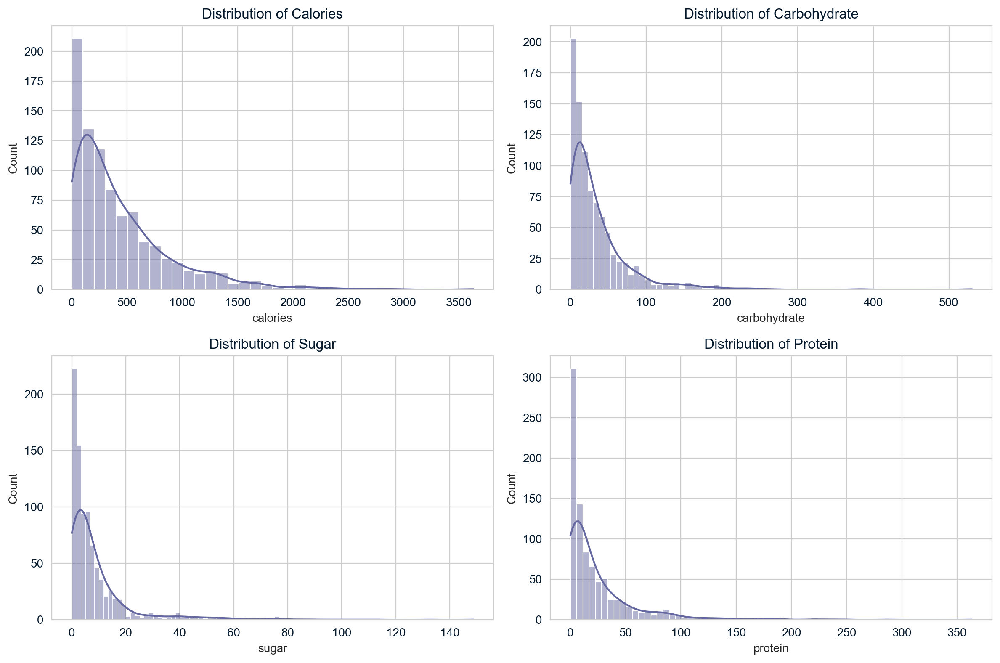
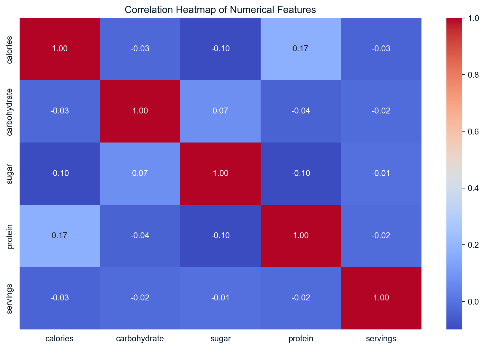
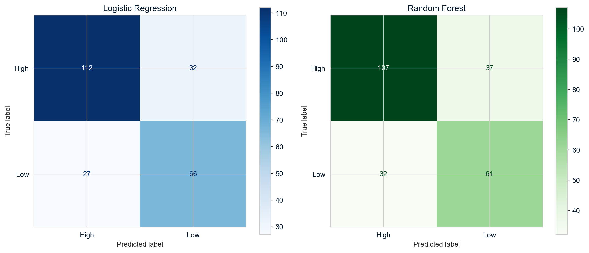

# Recipe Site Traffic Analysis

A data science and machine learning project that explores recipe characteristics and predicts whether a recipe is likely to generate high website traffic.

## Project Overview

The goal is to help a recipe website make more informed decisions about which recipes to promote. The project uses recipe-level nutritional information, serving size, and recipe category to classify recipes into **High** or **Low** traffic groups.

## Business Problem

The website wants to identify recipes that are more likely to attract high traffic before deciding which recipes to feature or promote. A classification model can support this decision-making process.

## Dataset

The dataset contains **947 recipes** and **8 columns**:

| Column | Description |
|---|---|
| `recipe` | Recipe identifier |
| `calories` | Calories per recipe |
| `carbohydrate` | Carbohydrate information |
| `sugar` | Sugar information |
| `protein` | Protein information |
| `category` | Recipe category |
| `servings` | Number of servings |
| `high_traffic` | Traffic label (High / Low) |

The original dataset includes missing values. The notebook documents the cleaning and preprocessing decisions used in the analysis.

## Workflow

1. **Data validation and cleaning** — convert nutritional fields to numeric values, standardize category and target labels, normalize serving counts, and handle missing values.
2. **Exploratory data analysis** — examine recipe category counts, traffic distribution, numerical feature distributions, and relationships between numerical variables.
3. **Preprocessing** — use median imputation and standard scaling for numerical features, and most-frequent imputation and one-hot encoding for categorical features.
4. **Model development** — train and compare Logistic Regression and Random Forest classifiers.
5. **Model evaluation** — compare accuracy, precision, recall, F1-score, and confusion matrices.
6. **Business evaluation** — assess whether the selected model meets the project's target of at least 80% precision for the High-traffic class.

## Results

The submitted notebook reports the following results:

| Metric | Logistic Regression | Random Forest |
|---|---:|---:|
| Accuracy | 75.11% | 70.9% |
| High-class precision | 80.58% | 77.0% |
| High-class recall | 77.78% | 74.3% |
| High-class F1-score | 79.15% | 75.6% |

**Selected model: Logistic Regression.**

It performs better than Random Forest across the reported metrics and exceeds the business precision target of 80% for High-traffic recipes.

## Key Exploratory Finding

The notebook's category-level analysis reports the highest High-traffic percentages for Vegetable (98.80%), Potato (94.32%), and Pork (91.67%) recipes. Beverages have the lowest reported percentage (5.43%).

These are observed associations in this dataset; they should not be interpreted as proof that category alone causes traffic.

## Business Recommendations

- Use the model as a decision-support tool when shortlisting recipes for homepage promotion.
- Consider historical category-level traffic patterns when planning featured content.
- Monitor model performance on new website data and retrain when traffic patterns change.
- Review predictions alongside editorial judgement and other business considerations.


## Visualizations

The notebook's saved chart outputs are also exported as standalone PNG files:















## Repository Structure

```text
recipe-site-traffic-analysis/
├── data/
│   └── recipe_site_traffic.csv
├── images/
│   └── visualizations/
├── notebooks/
│   └── recipe_site_traffic.ipynb
├── .gitignore
├── README.md
└── requirements.txt
```

## Installation and Usage

Clone the repository:

```bash
git clone https://github.com/YOUR_USERNAME/recipe-site-traffic-analysis.git
cd recipe-site-traffic-analysis
```

Install dependencies:

```bash
pip install -r requirements.txt
```

Start Jupyter:

```bash
jupyter notebook
```

Open `notebooks/recipe_site_traffic.ipynb` and run the cells. The notebook reads the dataset from `data/recipe_site_traffic.csv` using a relative path, so run it with the notebook in its repository folder.

## Technologies Used

- Python
- Pandas
- NumPy
- Matplotlib
- Seaborn
- Scikit-learn
- Jupyter Notebook

## Notes

This repository is a portfolio copy of a DataCamp certification practical project. Please check the dataset's terms before redistributing it publicly. The reported results are transcribed from the submitted notebook and should be revalidated by running the notebook in your environment.

---

**Project:** Recipe Site Traffic Analysis  
**Focus:** Data Analysis · Exploratory Data Analysis · Machine Learning · Classification
